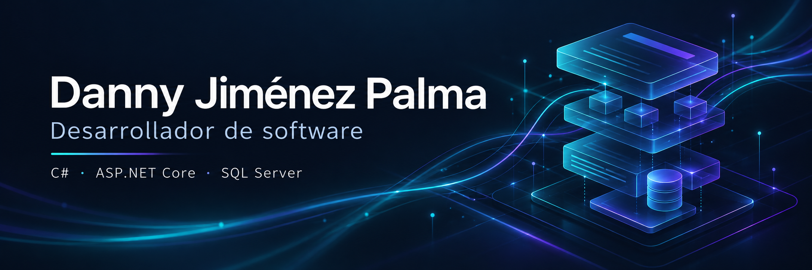

**C# · ASP.NET Core · SQL Server · Soporte de TI**  
Heredia, Costa Rica

[LinkedIn](https://www.linkedin.com/in/danny-jim%C3%A9nez-palma-089646312/) · [Contacto](mailto:djimenezcr07@gmail.com) · [Distribuidora JJ](https://github.com/djimenezcr07/Distribuidora-JJ)

## Software para procesos reales
Desarrollo aplicaciones web empresariales con C#, ASP.NET Core MVC y SQL Server para inventario, pedidos, facturación y administración. Combino el desarrollo con soporte de TI, atención a usuarios y documentación técnica.

## Experiencia
| Organización | Aporte | Periodo |
| --- | --- | --- |
| **On The Rush** | Desarrollo de soluciones, soporte de TI, gestión de incidencias y requerimientos. | 2024–actualidad |
| **Distribuidora JJ** | Desarrollo full stack de una aplicación web empresarial con tienda en línea y gestión administrativa. | 2022–2023 |
| **PMI Costa Rica Chapter** | Colaboración en soporte técnico, seguimiento de solicitudes y documentación. | 2025–actualidad |

## Proyecto destacado · Distribuidora JJ
Aplicación empresarial con comercio electrónico, inventario, pedidos, facturación y administración de clientes y empleados.

**C# · ASP.NET Core MVC · API REST · SQL Server · HTML · CSS · JavaScript · Bootstrap**

Autenticación por roles, validaciones del servidor, protección antiforgery y pruebas automatizadas con xUnit.

[Explorar el proyecto →](https://github.com/djimenezcr07/Distribuidora-JJ)

## Tecnologías y herramientas
- **Backend y datos:** C#, ASP.NET Core MVC, Web API, SQL y modelado relacional.
- **Frontend:** HTML5, CSS3, JavaScript y Bootstrap.
- **Calidad y entrega:** Git, xUnit, CI/CD, Azure DevOps Pipelines y Azure.
- **Soporte y CMS:** gestión de incidencias, documentación técnica y WordPress.

## Formación
**Bachillerato en Ingeniería en Sistemas de Computación**, Universidad Fidélitas · 2021–actualidad. Práctica profesional prevista para 2027.

- Scrum Fundamentals Certified · SCRUMstudy · 2023
- Introduction to Networks · Cisco Networking Academy · 2023
- Switching, Routing, and Wireless Essentials · Cisco Networking Academy · 2024
- Administración de sitios y desarrollo de temas · Learn WordPress · 2026

---
**Aprendizaje continuo · Resolución de problemas · Trabajo en equipo**
